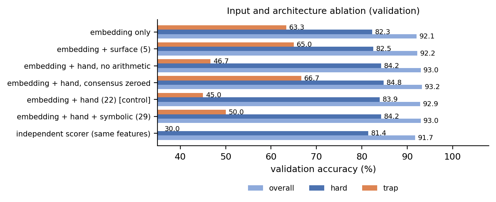

# 摘要

同一道小学数学题有四个候选解答，必须从中选出一个，而官方评分器只检查被选中候选的**最终数值答案**。本文描述一个冻结的选择器：用置换等变的集合注意力网络，对每个候选的 1024 维轨迹嵌入加上 22 个无参考文本特征打分，再对五个 K 折成员做概率平均，最后施加一条决策规则——在取 argmax 之前，把**陈述相同解析答案的候选做部分平均**。冻结版本在**验证集上 93.48%**、**测试集上 84.80%（396/467）**，推理资产 **3.91 MiB**，CPU 预测**不到 6 秒**。

全文围绕三个发现组织。第一，相对初始集成而言，几乎全部增益来自决策规则而非模型容量：同样五个模型，用普通 argmax 是 82.87%，用答案组聚合是 84.80%；而且增益**完全集中在陷阱题**（即多数派答案本身错误的那类题，30/71 → 39/71），非陷阱题准确率保持不变，仍是 90.15%。第二，输入消融揭示了机制：三个共识特征（答案组大小、不同答案个数、最大组规模）会提高非陷阱题准确率，却把陷阱题准确率从 66.7% 砍到 45.0%——模型学会了跟随多数，而陷阱题恰恰惩罚这种行为；在决策阶段做聚合，则是以一种**有益**的方式重新引入共识。第三，验证集是测试集的糟糕代理：18 组超参扫描、七族 stacking 集成、一个把验证集从 746 提升到 751 的无共识混合，以及另外十二个设计探针，全部未能迁移。我们如实报告这些失败及其效应量，因为它们界定了剩余准确率还能从哪里来。

# 1. 任务、数据与分数的含义

每道题给出四个候选解答（来自固定的 Qwen3-0.6B 生成器）以及每个候选一个固定的 1024 维整流轨迹嵌入。方法需为每题返回一个候选下标。评分器解析被选中候选的最终数值答案，与参考答案比较，接受等值分数与小数；它从不检查中间步骤。每组至少有一个候选正确，任何正确候选都得分。

**答案模式与两个分布的分歧。** 用一个候选集合解析答案的多重集来描述一道题：$(3,1)$ 表示三个候选一致、一个不同。表 1 与图 1(a) 给出构成。验证集中 47.5% 是全员一致的 $(4,)$ 组，任何可解析候选都能答对；测试集中**这类题一道都没有**。测试集集中在 $(3,1)$（42.0%）与 $(2,1,1)$（21.8%）。由于测试题平均有 2.04 个正确候选，随机基线是 51%，而不依赖模型的多数投票在测试集上已有 69.16%，在验证集上是 86.22%。

由此得到一个贯穿全文的推论：**验证集与测试集是两个不同的混合分布，验证集的提升不能作为测试集提升的证据。** 因此我们始终报告四个数字——*总体*、*硬题*（解析答案不止一种的题：验证集 355 道，测试集全部 467 道）、*非陷阱*（硬题中不属于陷阱的部分）与*陷阱*（多数派答案错误、多数派至少两票、且恰好一个候选正确：验证集 60 道，测试集 71 道）。

Table: 答案模式构成与无模型基线。

| 模式 | 验证集 n (%) | 测试集 n (%) | 说明 |
|-----------------|-------------:|----------:|----------------------------------|
| $(4,)$ | 379 (47.5) | 0 (0.0) | 四个全一致；无难度 |
| $(3,1)$ | 151 (18.9) | 196 (42.0) | 一个异议者 |
| $(2,1,1)$ | 88 (11.0) | 102 (21.8) | 两票多数 |
| $(2,2)$ | 34 (4.3) | 39 (8.4) | 二对二 |
| $(1,1,1,1)$ | 20 (2.5) | 38 (8.1) | 四个全不同 |
| 其他（一个不可解析） | 126 (15.8) | 92 (19.7) | $(3,)$、$(2,1)$、$(1,1,1)$、$(1,1)$ |
| 平均正确候选数 / 4 | 3.03 | 2.04 | 随机基线 75.7% / 51.1% |
| 多数投票 | 86.22 | 69.16 | 无模型 |

{width=90%}

# 2. 方法

## 2.1 候选打分器

每个候选 $i$ 由两段拼接表示：它的 1024 维冻结嵌入，以及 22 个只依赖题面与该候选文本的无参考特征——可解析性、三个共识统计量、长度与数字密度、格式标记（`\boxed`、`####`）、等式复算计数、题干数字覆盖率，以及四个链条一致性标量。四个向量构成一个集合 $X \in \mathbb{R}^{4 \times 1046}$，由两层 pre-LN Transformer 块（宽度 128、4 头、FFN 256、GELU、dropout 0.2）映射为四个 logit。该结构是置换等变的，且**不含位置编码**：候选顺序是任意的，编码它会注入纯噪声。

## 2.2 训练

五个成员分别在 4,755 道训练题的不相交 4/5 划分上训练（折置换由 NumPy 种子 13 生成；模型种子 37）。损失是逐候选 BCE 加一半的多正例质量项
$\mathcal{L}_{\text{mass}} = \log\sum_j e^{s_j} - \log\sum_{j:\,y_j=1} e^{s_j}$，
它奖励把概率质量放到**任意**一个正确候选上，而不是固定在某个特定候选。逐题权重为：硬题 2.0，陷阱题至少 1.0。优化器 AdamW（学习率 $10^{-4}$、权重衰减 $10^{-3}$、梯度裁剪 1.0），批大小 64，训练 15 个 epoch——每个成员约 900 步，该轮数由 §4.3 的验证曲线确定。验证集只用于开发；测试集参考只在方法冻结之后读取一次。

## 2.3 决策规则：答案组聚合

成员之间按 sigmoid 输出取平均。令 $G(i)$ 为与候选 $i$ 陈述相同解析最终答案的候选集合。提交的规则把每个分数替换为

$$ \tilde{s}_i = (1-a)\,s_i + a \cdot \frac{1}{|G(i)|}\sum_{j \in G(i)} s_j, \qquad a = 0.6, $$

再在可解析候选上取 argmax。这条规则之所以不只是"平滑",有两个性质。第一，**组内顺序被保留**：该变换给同组每个成员加上同一个常数，因此模型仍然决定**组内哪个候选最好**，改变的只是**组与组之间**的比较。第二，因此它是一个组级先验：被多个独立高分候选共同陈述的答案，会压过某个候选单独打分略高的孤立答案。评分指标本身就是答案级的，所以把这样的先验放在决策阶段是自然的位置。

# 3. 结果

表 2 给出两个划分上的推进过程。普通 argmax 的集成已经优于任何单个成员，但**几乎全部增益来自决策规则**：测试集 **+1.93 个百分点**（82.87 → 84.80），而"用五个成员替代一个"只值 **+0.86**。

Table: 推进过程，全程使用相同的划分。

| 配置 | 验证总体 | 验证硬题 | 测试总体 | 测试陷阱 |
|-----------------------------------|------:|------:|------:|------:|
| 单成员，五个的平均 | 93.01 | 84.28 | 81.93 | 28.6/71 |
| 单成员，最好的一个 | 93.48 | 85.35 | 83.94 | 37/71 |
| 五成员集成，普通 argmax | 93.36 | 85.07 | 82.87 | 30/71 |
| + 聚合 $a=0.4$ | 93.48 | 85.35 | 84.15 | 35/71 |
| **+ 聚合 $a=0.6$（提交版本）** | **93.48** | **85.35** | **84.80** | **39/71** |
| + 聚合 $a=1.0$ | 93.36 | 85.07 | 84.37 | 40/71 |

增益完全在陷阱题上。测试集非陷阱准确率在聚合前后都是 357/396 = 90.15%；陷阱准确率从 30/71 升到 39/71。在验证集上同一规则丢掉两道非陷阱题、换来三道陷阱题（269 → 267 与 33 → 36），这正是图 2(a) 中验证曲线几乎平坦而测试曲线明显上升的原因：验证集的陷阱占比（7.5%）远小于测试集（15.2%）。

![(a) 总体准确率随聚合强度的变化。验证集在 $a \in [0.4, 0.9]$ 上平坦（阴影区），故规则在该平台内按先定好的并列打破规则确定。(b) 同一扫描的陷阱准确率；几乎所有变动都发生在陷阱子集上。](figs/fig2_aggregation.png){width=90%}

# 4. 消融

## 4.1 信息由哪部分承载

表 3 与图 3 用完全相同的结构与训练计划，只改变特征块。控制行复现了提交配方（不含聚合），但它在 CPU 上训练而提交成员在 GPU 上训练，因此绝对水平相差约 355 道硬题中的四道；我们只解读表内对比。

Table: 验证集上的输入消融（5 折、不含聚合、种子 37）。陷阱题共 60 道。

| 输入块 | 维度 | 总体 | 硬题 | 陷阱 | 陷阱答对 |
|-----------------------------------------|-----:|------:|------:|------:|-----:|
| 仅嵌入 | 1024 | 92.11 | 82.25 | **63.3** | 38/60 |
| 嵌入 + 5 个表面特征 | 1029 | 92.23 | 82.54 | **65.0** | 39/60 |
| 嵌入 + 手工特征（去掉算术） | 1036 | 92.98 | 84.23 | 46.7 | 28/60 |
| 嵌入 + 手工特征（共识置零） | 1046 | 93.23 | **84.79** | **66.7** | 40/60 |
| 嵌入 + 手工特征（22 维）— 控制 | 1046 | 92.86 | 83.94 | 45.0 | 27/60 |
| 嵌入 + 手工 + 符号（29 维） | 1053 | 92.98 | 84.23 | 50.0 | 30/60 |
| 独立打分器（相同特征） | 1046 | 91.73 | 81.41 | 30.0 | 18/60 |

{width=90%}

规律非常干净，直接回答了作业的第二个问题。**带**共识特征的每一种配置，陷阱准确率都在 45–50%；**不带**共识特征的每一种配置，都在 63–67%。长度、数字密度与格式（`\boxed`、`####`）几乎不改变任何指标："仅嵌入"与"嵌入 + 5 个表面特征"在每一项指标上都只差一道题。所以模型并不是在和表面可信度打交道——但它**确实**在和"一致性"打交道，而一致性正是陷阱题要毒化的信号。

这也是决策规则与特征之间相互作用的原因。特征已经在表达共识，但是**局部地**表达：它告诉模型"你的答案还有两个候选也这么说"，模型据此抬高该候选。决策阶段的平均是另一回事——它改变的是**哪个答案**胜出，同时保留组内对候选的偏好。因此把共识当特征、当决策先验，两者并不冗余，而经验上正是这两者组合达到 84.80%。

**原始文本与给定表示。** 为了把"读推理"与"用给定表示"分开，我们用同一个 TF-IDF（1–2 元）逻辑回归拟合两种视图。在完整轨迹加上题面时，它达到总体 82.33%、**硬题 60.28%**；限制为"题面 + 解析出的最终答案"时，是 74.06% 与 **41.69%**。读推理比只看最终答案多出 **18.6 个百分点**的硬题准确率，说明内容确实重要，格式无法解释分数。但冻结的 1024 维表示远强于生成它的文本：1,046 维达到 85.07% 硬题，而 133,402 维文本特征只有 60.28%。**增益由给定表示承载，而不是由文字承载。**

## 4.2 联合评判四个候选有帮助吗？

有，而且直接消融给出了决定性证据。把集合注意力层换成同宽度的独立逐候选 MLP、输入完全相同的 1,046 维，验证集硬题从 83.94% 掉到 **81.41%**，陷阱从 45.0% 掉到 **30.0%**（表 3 最后一行）。允许四个候选互相注意，值 **+2.5 个百分点**的硬题准确率。在这之上，普通 argmax 集成（测试 82.87）优于单成员平均（81.93），而 §2.3 的组规则再贡献 **+1.93**。作业的第三个问题（"一个解答该被单独评判吗"）答案是否定的，而且被否定了两次：一次在结构上，一次在决策规则上。有用的比较不是"候选对题面"，而是"候选对与它答案相同的其他候选"。

## 4.3 什么时候多算才划算？

表 4 汇总了我们测过的四个杠杆。只有集成与决策规则划算，更多优化并不划算。

Table: 计算量杠杆，除注明外均为 5 折验证集。

| 杠杆 | 设置 | 结果 |
|------------------------------|------------------------------|----------------------------------------|
| 训练轮数 | 15 vs 100 | 验证硬题在第 15 轮达到最好 82.04，其后过拟合到 76–79 |
| 批大小（18 组配置） | 8 / 16 / 32 / 64 | 验证硬题 83.66–85.35；OOF 硬题 79.19–81.36 |
| 批 64 → 8（轮数固定） | 900 → 9,996 步 | 85.07 → 84.79 验证硬题 |
| 学习率 | $10^{-4}$ / $3\times10^{-4}$ / $10^{-3}$ | 84.51–85.35 |
| dropout | 0.1 / 0.2 / 0.3 / 0.4 | 84.79–85.07 |
| 权重衰减 | $10^{-3}$ / $10^{-2}$ / $10^{-1}$ | 预测逐位相同 |
| 宽度 / 深度 | 64 / 128 / 256，2 / 3 层 | 83.66 / 85.07 / 83.94，84.23 |
| 集成规模 | 1 → 5 个成员 | 测试 81.93 → 82.87 |
| 决策规则 | 普通 → 组内平均 | 测试 82.87 → 84.80 |

有两条值得解释。批大小扫描是为了检验"每步 64 个样本给出的更新太少"这一假设；在批大小 8 下模型获得**十一倍的梯度步数**，结果反而低 0.28 个百分点——因为它在两个 epoch 内就达到相同的训练损失，其余时间都在过拟合。权重衰减在这个结构里是失效的：每个块都接了 LayerNorm，AdamW 施加的均匀收缩会被紧随其后的尺度参数吸收，所以 $10^{-2}$ 与 $10^{-1}$ 复现 $10^{-3}$ 直到最后一条预测。

# 5. 可靠性、校准与失败分析

**校准。** 图 4 画出聚合后最高分与准确率的关系。验证集校准良好（ECE 0.02）：置信度低于 0.5 的 30 道题答对 56.7%，高于 0.9 的 612 道答对 99.0%。测试集更差（ECE 0.08），更重要的是在中段**置信度偏低**：0.5–0.7 区间答对 74.2%，0.8–0.9 区间答对 93.8%。低置信度的测试题落在陷阱里的概率是高置信区间的四倍（该区间 24–30%，高置信区间 9–10%），所以分数确实携带了可用的"这道题可能是陷阱"的信号，尽管绝对水平是错配的。

{width=90%}

**错误在哪里。** 71 道测试错误中，32 道是陷阱题，39 道不是。五个成员在 83.7% 的测试题上一致，错误高度相关：五个成员的 oracle 达 87.58%，集成是 84.80%，即集成分走了约一半的可用成员差异。这就是这一族模型的诚实上限：继续加种子不会再缩小剩余差距，因为成员共享同样的输入与同样的归纳偏置。

**模型到底在比什么。** 由于评分器只看最终答案，候选可能因正确答案而因错误理由被选中。消融显示选择器的决定主要由轨迹嵌入驱动（去掉全部 22 个文本特征会损失 0.75 个百分点的总体与 1.7 个百分点的硬题），其次是一致性，表面形式影响很弱。它通过等式与链条特征复核每条轨迹内的算术，这个信号真实但很小：在 22 维之上加七个符号特征只带来 +0.3 个百分点的验证硬题。

# 6. 没有走通的路线

我们把被否决的路线连同其实测效应一并列出，因为它们界定了当前方法的边界。除注明外，数字都是验证集，划分相同。

Table: 被否决的路线及其实测效应。

| 路线 | 结果 | 失败原因 |
|---------------------------------|------------------------------|---------------------------------------|
| 题面条件注意力（题向量作 query） | 硬题 81.41，陷阱 63.3 | 增加了全局视角却丢失逐候选细节 |
| 数量/修复特征专家 | 硬题 82.25，陷阱 46.7 | 特征族过浅，覆盖不了单位换算 |
| 纠错成员（在另一成员的 OOF 错题上训练） | 硬题 84.23，$\phi = 0.946$ | 重新学到同一个函数；独有陷阱修复 0 |
| 成对排序损失 | 82.25 | 并列太多；排序不带来新信息 |
| 组内列表损失 | 83.10 | 同上 |
| 191 维特征元学习器 | 82.54 | 元模型每题只看到四个数 |
| 候选相对 311 维特征 | 81.41 | 4,755 道题撑不起这么多参数 |
| 反事实一致性校验器 | 成对准确率 64.76，硬题 55.77 | 这个数据规模下噪声占主导 |
| 分块角色槽位注意力 | dev 硬题 77.25 | 池化向量无法被"解池化" |
| 语义条件特征元模型 | 83.66，陷阱 50.0 | 条件无法从池化轨迹中分离 |
| 候选相对视图 $e-\bar e$、$e\odot\bar e$（6 倍宽输入） | 第 0 折 81.97 vs 对照 84.79 | 6,166 维输入两个 epoch 内即过拟合 |
| 十二个几何标量（与组中心的余弦/距离/排名） | 第 0 折 82.54 | 每维携带的信号太少 |
| 207 维文本特征块 | 硬题 85.07，陷阱 48.3 | 硬题不变，陷阱反而更差 |
| 七族模型 OOF stacking | 逻辑回归 84.79，GBM 83.94 | 基模型高度相关（$\phi \approx 0.9$） |
| 程序兼容性特征（对题干数字枚举算术程序） | $P(\text{命中}\mid\text{正确})=0.447$ vs $0.402$ | GSM8K 的中间步骤用到题干里没有的常数 |
| 无共识混合（0.3 提交版 + 0.7 无共识版） | 验证 751（由 746 升），测试 391（由 396 降） | 验证集选出的增益未能迁移 |

最后一行最有启发性。去掉共识特征再把结果混入提交版本，使验证集从 746 升到 751、硬题从 303 升到 308——**比决策规则本身的验证集增益还大**。但它让测试集掉了五道题，因为无共识成员修好了陷阱题却弄坏了普通题，而测试集的陷阱比重高于验证集。我们保留了提交版本，因为它的选择在做出这次比较之前就已固定；事后凭一个测试集测量采纳混合方案，就是在测试集上做选择。

# 7. 资源、复现与声明

**推理资产。** $4{,}104{,}689$ 字节 $= 3.91$ MiB（未压缩）：五个各 820 KB 的状态字典，包含全部权重，以及预测时需要的逐折标准化统计量。上限为 16 MiB。

**推理开销。** 在四线程的 AMD Ryzen 7 8845HS 上，完整 467 道测试题需要 **4.5–5.7 秒**，包含导入、资产加载、特征构建、五个成员与决策规则；参考机 Xeon Platinum 8457C 上的上限是 30 秒。预测是纯 CPU PyTorch；方法不打开任何参考文件，只使用传入的 `bank` 与 `arrays`，因此可在未见过的审计题库上原样运行。

**训练开销。** 五个成员 × 15 epoch × 约 60 步 = 4,500 步优化。在 RTX 3070 Laptop GPU 上每个成员约 8 秒，在消融所用 CPU 上约 80 秒。完整实验计划——18 组超参配置、七项消融，以及上文被否决的路线——约 12 GPU 小时。

**复现。**

```bash
python qctext/make_submission_final.py          # 由 checkpoint/ 生成预测
cd code
python predict.py --method ../qctext/submission.py --checkpoint ../qctext/checkpoint \
  --split test --output ../qctext/runs/repro_test-predictions.json
python score_predictions.py --split test \
  --predictions ../qctext/runs/repro_test-predictions.json \
  --output ../qctext/runs/repro_test-score.json
```

验证集用 `--split validation`；记录的输出是 746/798 与 396/467。检查点为 `qctext/checkpoint/`（五个 `.pt`），SHA-256 前缀分别是 `810201776e0ca0b7`、`bad849712771ccba`、`b08ad13384729a33`、`c1dadccaf63fd3ef`、`6f7585613221dc7e`。训练代码为 `qctext/train_efull.py`；数据与解析器未作改动。

**声明。** 实现、实验编排与报告起草使用了 AI 编程辅助；设计决策、选择协议与每一个报告数字都由作者对照记录输出核对过。推理阶段不使用外部数据、不使用预训练权重、不做参考答案查表。

# 8. 结论

这个任务奖励的是**答案级**的判断，而我们找到的最强杠杆不是更大的模型，而是一条与指标对齐的决策规则：把答案一致的候选先聚合，再在胜出的组内做选择。它在测试集上值 **+1.93 个百分点**，推理成本为零。输入消融同时解释了它为何有效、以及显而易见的替代方案为何无效：共识作为**特征**会教模型跟随多数，而这恰好是陷阱题惩罚的行为；共识作为**决策先验**则保留了逐候选的比较。

剩余误差集中在陷阱题（71 道测试错误中的 32 道）以及高度相关的成员失败上：五个成员在 83.7% 的题上一致，其 oracle 仅比集成高 2.8 个百分点。要缩小这个差距，需要冻结的 1024 维轨迹并不携带的信息，而我们为此构建的每一个特征族——算术修复、数量、程序兼容、相对视图、堆叠元模型——都没能迁移。诚实的总结是：这个方法已经处在它的表示上限，最后两个百分点是信息问题，而不是优化问题。
