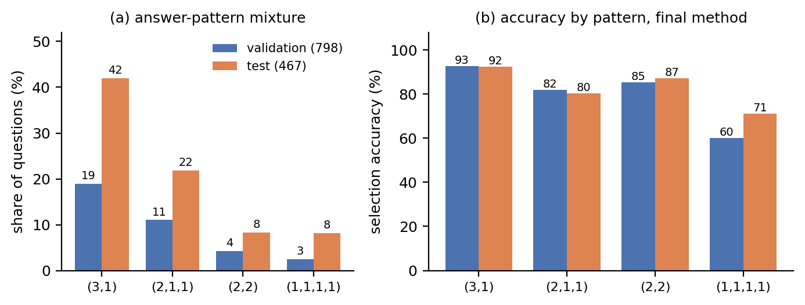
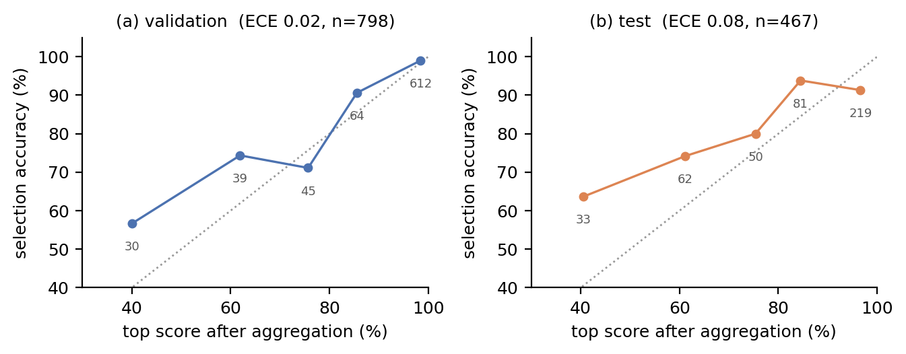

# Abstract

Four candidate solutions to the same grade-school maths problem must be reduced to one, and the official scorer only checks the selected candidate's final numeric answer. We describe a frozen selector that scores the four candidates jointly with a permutation-equivariant set-attention network over the supplied 1024-dimensional trace embeddings plus 22 reference-free text features, averages five K-fold members, and then applies one decision rule: candidates that state the same parsed answer are partially pooled before the argmax. The frozen submission obtains **93.48 % on validation and 84.80 % on test (396/467)** with **3.91 MiB** of inference assets and **under 6 s** of CPU prediction. Three findings organise the report. (i) Almost all of the gain over the initial ensemble comes from the decision rule, not from more capacity: the same five models score 82.87 % with a plain argmax and 84.80 % with answer-group pooling, and the improvement is concentrated entirely in *traps* — questions where the plurality answer is wrong (30/71 → 39/71), with non-trap accuracy unchanged at 90.15 %. (ii) An input ablation shows the mechanism: the three consensus features (group size, number of distinct answers, largest group) raise non-trap accuracy but cut trap accuracy from 66.7 % to 45.0 % on validation. The selector learns to follow the majority, which is exactly what a trap punishes; pooling at decision time re-introduces consensus in a form that helps instead. (iii) The validation split is a poor proxy for the test split: an 18-configuration hyper-parameter sweep, a seven-family stacking ensemble, a consensus-free blend that raised validation from 746 to 751, and twelve further design probes all failed to transfer. We report those failures with their measured effect sizes, because they bound where the remaining accuracy can come from.

# 1. Task, data and what the score can mean

Each question supplies four candidate traces from a fixed Qwen3-0.6B generator and a fixed 1024-d whole-trace embedding per candidate. A method returns one index per question. The scorer parses the selected candidate's final numeric answer and compares it with the reference, accepting equivalent fractions and decimals; it never inspects intermediate steps. Any correct candidate earns the point, and every group has at least one.

**Answer patterns and the split shift.** We describe a question by the multiset of parsed final answers among its four candidates: $(3,1)$ means three agree and one differs. Table 1 and Figure 1(a) show the composition. Validation is 47.5 % all-agree $(4,)$ groups, which any parseable candidate answers; test contains none. Test instead concentrates on $(3,1)$ (42.0 %) and $(2,1,1)$ (21.8 %). Because test questions average 2.04 correct candidates, chance is 51 %, and a no-model majority vote already scores 69.16 % on test and 86.22 % on validation.

The consequence matters for everything that follows: **validation and test are different mixtures, so a validation gain is not evidence of a test gain.** We therefore report four numbers throughout — *overall*, *hard* (questions with more than one distinct parsed answer: 355 validation, all 467 test), *non-trap* (hard questions that are not traps) and *trap* (the plurality answer is wrong, the plurality has at least two votes, exactly one candidate is correct: 60 validation, 71 test).

Table: Answer-pattern composition and no-model baselines.

| Pattern | Validation n (%) | Test n (%) | Note |
|-----------------|-------------:|----------:|----------------------------------|
| $(4,)$ | 379 (47.5) | 0 (0.0) | all four agree; trivial |
| $(3,1)$ | 151 (18.9) | 196 (42.0) | one dissenter |
| $(2,1,1)$ | 88 (11.0) | 102 (21.8) | two-vote plurality |
| $(2,2)$ | 34 (4.3) | 39 (8.4) | two versus two |
| $(1,1,1,1)$ | 20 (2.5) | 38 (8.1) | all different |
| other (one unparseable) | 126 (15.8) | 92 (19.7) | validation $(3,)$ 50, $(2,1)$ 28, $(1,1,1)$ 20, $(1,1)$ 14, $(2,)$ 11, $(1,)$ 3; test $(2,1)$ 50, $(1,1,1)$ 24, $(1,1)$ 18 |
| mean correct candidates / 4 | 3.03 | 2.04 | chance 75.7 % / 51.1 % |
| majority vote | 86.22 | 69.16 | no model |

{width=90%}

# 2. Method

## 2.1 Candidate scorer

Each candidate $i$ is represented by its 1024-d frozen embedding concatenated with 22 reference-free text features computed only from the question and that candidate: parseability, the three consensus statistics, length and digit density, formatting flags (`\boxed`, `####`), equation re-checking counts, coverage of the question's numbers, and four chain-consistency scalars. The four vectors form a set $X \in \mathbb{R}^{4 \times 1046}$, and a two-layer pre-LN transformer block set (width 128, 4 heads, FFN 256, GELU, dropout 0.2) maps it to four logits. The architecture is permutation-equivariant and contains no positional encoding: candidate order is arbitrary, so encoding it would inject noise.

## 2.2 Training

Five members are trained on the 4,755 training questions with disjoint held-out folds — each member holds out a different fifth, so the five 4/5 training subsets overlap (fold permutation from NumPy seed 13; model seed 37). The loss is a per-candidate BCE plus half the multi-positive mass term
$\mathcal{L}_{\text{mass}} = \log\sum_j e^{s_j} - \log\sum_{j:\,y_j=1} e^{s_j}$,
which rewards putting probability mass on *any* correct candidate rather than on one arbitrary one. Per-question weights are 2.0 for hard questions and at least 1.0 for traps. We use AdamW (lr $10^{-4}$, weight decay $10^{-3}$, gradient clipping 1.0), batch 64 and 15 epochs — roughly 900 optimiser steps per member, chosen by the validation curves in §4.3. Validation is used for development only; test references are read once, after the method was frozen.

## 2.3 Decision rule: answer-group aggregation

Members are combined by averaging their sigmoid outputs. Let $G(i)$ be the set of candidates that state the same parsed final answer as candidate $i$. The submitted rule replaces each score by

$$ \tilde{s}_i = (1-a)\,s_i + a \cdot \frac{1}{|G(i)|}\sum_{j \in G(i)} s_j, \qquad a = 0.6, $$

and returns the argmax over parseable candidates. The strength was fixed on validation alone, over the grid $a \in \{0, 0.1, \dots, 1.0\}$: every value in $[0.4, 0.9]$ ties the validation maximum (746/798, hard 303/355), and the pre-declared tie-break is highest validation trap accuracy (36/60, reached from $a \ge 0.6$), then the smallest $a$, which gives 0.6. Two properties make this rule more than a smoothing trick. First, **within-group order is preserved**: the transformation adds the same constant to every member of a group, so the model still decides *which* of the agreeing candidates is best. Only the comparison *between* answer groups changes. Second, it is therefore a group-level prior: an answer stated by several independently high-scoring candidates outranks a singleton that one candidate scored slightly higher. The scorer's own metric is answer-level, so this is the natural place to put such a prior.

# 3. Results

Table 2 gives the progression on both splits. The plain-argmax ensemble already beats every individual member, but the decision rule is responsible for almost all of the gain: **+1.93 pp test (82.87 → 84.80)** against **+0.86 pp from pooling five members instead of one**.

Table: Progression, same splits throughout.

| Configuration | Val overall | Val hard | Test overall | Test trap |
|-----------------------------------|------:|------:|------:|------:|
| single member, mean of five | 93.01 | 84.28 | 81.93 | 28.6/71 |
| single member, best on validation (f1, plain argmax) | 93.48 | 85.35 | 81.58 | 30/71 |
| five-member ensemble, plain argmax | 93.36 | 85.07 | 82.87 | 30/71 |
| + aggregation $a=0.4$ | 93.48 | 85.35 | 84.15 | 35/71 |
| **+ aggregation $a=0.6$ (submitted)** | **93.48** | **85.35** | **84.80** | **39/71** |
| + aggregation $a=1.0$ | 93.36 | 85.07 | 84.37 | 41/71 |

The gain is entirely in traps. Non-trap test accuracy is 357/396 = 90.15 % both before and after; trap accuracy rises from 30/71 to 39/71. On validation the same rule loses two hard non-trap questions and gains three trap questions (hard non-trap 269 → 267, trap 33 → 36; over the full split, non-trap 712 → 710). That flatness is why the validation curve in Figure 2(a) barely moves while the test curve does: validation's trap share (7.5 %) is much smaller than test's (15.2 %).

![(a) Overall accuracy against aggregation strength. Validation is flat over $a \in [0.4, 0.9]$ (shaded), so the rule was fixed by tie-break inside that plateau. (b) The same sweep by trap accuracy; almost all movement is on the trap subset.](figs/fig2_aggregation.png){width=90%}

# 4. Ablations

## 4.1 Which input carries the information

Table 3 and Figure 3 train the identical architecture and schedule while changing only the feature block. The control row reproduces the submitted recipe (without aggregation) but is trained on CPU while the submitted members were trained on GPU, so absolute levels differ by about four of the 355 hard validation questions; only within-table contrasts are interpreted.

Table: Input ablation on validation (5-fold, no aggregation, seed 37). Trap = 60 questions.

| Input block | dim | Overall | Hard | Trap | Trap ok |
|-----------------------------------------|-----:|------:|------:|------:|-----:|
| embedding only | 1024 | 92.11 | 82.25 | **63.3** | 38/60 |
| embedding + 5 surface features | 1029 | 92.23 | 82.54 | **65.0** | 39/60 |
| embedding + hand, arithmetic removed | 1036 | 92.98 | 84.23 | 46.7 | 28/60 |
| embedding + hand, consensus zeroed | 1046 | 93.23 | **84.79** | **66.7** | 40/60 |
| embedding + hand (22) — control | 1046 | 92.86 | 83.94 | 45.0 | 27/60 |
| embedding + hand + symbolic (29) | 1053 | 92.98 | 84.23 | 50.0 | 30/60 |
| independent per-candidate scorer (same features) | 1046 | 91.73 | 81.41 | 30.0 | 18/60 |

{width=90%}

The pattern is sharp and it answers the assignment's second question directly. Every configuration **with** consensus features sits at 45–50 % trap accuracy; every configuration **without** them sits at 63–67 %. Length, digit density and formatting (`\boxed`, `####`) change almost nothing: "embedding only" and "embedding + 5 surface features" are within one question on every metric. So the model is not scoring surface plausibility — but it *is* scoring agreement, and agreement is precisely the signal a trap poisons.

This is why the decision rule and the features interact. The features already express consensus, but locally: they tell the model "your answer is shared by two others", and the model responds by raising that candidate. Pooling at decision time is a different operation — it changes which *answer* wins, while preserving which candidate within the answer is preferred. Feeding consensus as a feature and applying it as a group prior are therefore not redundant, and empirically the pair is what reaches 84.80 %.

**Raw text versus the supplied representation.** To separate "reading the reasoning" from "using the supplied representation", we fit the same TF-IDF (1–2 gram) logistic model to two views of the candidates. On the full trace plus its question it reaches 82.33 % overall and **60.28 % hard**; restricted to the question and the parsed final answer it reaches 74.06 % and **41.69 % hard**. Reading the reasoning is worth +18.6 pp of hard accuracy over the final answer alone, so content matters and formatting alone cannot explain the score. But the frozen 1024-d representation is far stronger than the text that produced it: 85.07 % hard with 1,046 dimensions, against 60.28 % with 133,402 text features. The improvement is carried by the supplied representation, not by the words.

## 4.2 Does judging the four candidates jointly help?

Yes, and the direct ablation is decisive. Replacing the set-attention layer with an independent per-candidate MLP of the same width, over exactly the same 1,046 input dimensions, drops validation hard accuracy from 83.94 % to **81.41 %** and trap accuracy from 45.0 % to **30.0 %** (Table 3, last row). Allowing the four candidates to attend to each other is worth +2.5 pp of hard accuracy. On top of that, the plain-argmax ensemble (82.87 test) beats the mean single member (81.93), and the group rule of §2.3 adds a further +1.93 pp. The assignment's third question ("should a solution be judged on its own?") is answered no, twice over: once by the architecture and once by the decision rule. The useful comparison is not candidate-versus-question but candidate-versus-the-other-candidates-that-agree-with-it.

## 4.3 When does more computation pay off?

Table 4 collects the four levers we measured. Only ensembling and the decision rule pay; more optimisation does not.

Table: Computation levers, 5-fold validation unless stated.

| Lever | Setting | Result |
|------------------------------|------------------------------|----------------------------------------|
| epochs | 15 vs 100 | best validation hard 82.04 at epoch 15, then overfits to 76–79 |
| batch size (18 configs) | 8 / 16 / 32 / 64 | validation hard 83.66–85.35; OOF hard 79.19–81.36 |
| batch 64 → 8 at fixed epochs | 900 → 9,996 steps | 85.07 → 84.79 validation hard |
| learning rate | $10^{-4}$ / $3\times10^{-4}$ / $10^{-3}$ | 84.51–85.35 |
| dropout | 0.1 / 0.2 / 0.3 / 0.4 | 84.79–85.07 |
| weight decay | $10^{-3}$ / $10^{-2}$ / $10^{-1}$ | bit-identical predictions |
| width / depth | 64 / 128 / 256, 2 / 3 layers | 83.66 / 85.07 / 83.94, 84.23 |
| ensemble size | 1 → 5 members | 81.93 → 82.87 test |
| decision rule | plain → pooled | 82.87 → 84.80 test |

Two entries deserve comment. The batch sweep was run to test the hypothesis that 64 samples per step gave too few updates; at batch 8 the model receives **eleven times the gradient steps** and lands 0.28 pp *lower*, because it reaches the same training loss in two epochs and spends the rest overfitting. Weight decay is inert in this architecture: every block is LayerNorm-normalised, so the uniform shrinkage that AdamW applies is absorbed by the following scale parameter, and $10^{-2}$ and $10^{-1}$ reproduce $10^{-3}$ to the last prediction.

# 5. Reliability, calibration and failure analysis

**Calibration.** Figure 4 plots accuracy against the top score after aggregation. Validation is well calibrated (ECE 0.02): the 30 questions below 0.5 confidence are answered at 56.7 %, the 612 above 0.9 at 99.0 %. Test is worse (ECE 0.08) and, more importantly, *under*-confident in the middle: the 0.5–0.7 bin is answered at 74.2 % and the 0.8–0.9 bin at 93.8 %. Low-confidence test questions are also four times more likely to be traps (24–30 % of the bin versus 9–10 % at high confidence), so the score does carry a usable "this one is probably a trap" signal even though it is miscalibrated in level.

{width=90%}

**Where the errors are.** Of the 71 test errors, 32 are traps and 39 are not. The five members agree pairwise on 83.8 % of test questions (all five choose the same candidate on 68.3 %), and their errors are highly correlated: the oracle over the five reaches 87.58 %, the ensemble 84.80 %, so the ensemble captures about half of the available member diversity. That is the honest ceiling of this family of models: no amount of further seed averaging will close the remaining gap, because the members share the same inputs and the same inductive bias.

**What the model actually compares.** Because the scorer only checks final answers, a candidate can be selected for the right answer and the wrong reason. Our ablations show the selector's decision is driven by the trace embedding (removing all 22 text features costs 0.75 pp overall and 1.7 pp of hard accuracy) and by agreement, and only weakly by surface form. It re-checks arithmetic inside each trace through the equation and chain features, and the resulting signal is real but small: adding the seven symbolic features to the 22 changes validation hard by +0.3 pp.

# 6. What did not work

We list the rejected routes with their measured effect, because they define the boundary of the current method. All numbers are validation unless marked; all use the same splits.

Table: Rejected routes and their measured effect.

| Route | Result | Why it failed |
|---------------------------------|------------------------------|---------------------------------------|
| Question-conditioned attention (question vector as query) | hard 81.41, trap 63.3 | adds a global view but loses per-candidate detail |
| Quantity / repair feature expert | hard 82.25, trap 46.7 | feature family too shallow for unit conversions |
| Error-correcting member (trained on another member's OOF errors) | hard 84.23, $\phi = 0.946$ | re-learns the same function; 0 unique trap fixes |
| Pairwise ranking loss | 82.25 | ties abundant; ranking does not add information |
| Listwise (group) loss | 83.10 | same |
| 191-dimensional feature meta-learner | 82.54 | meta sees four numbers per question |
| Candidate-relative 311-d features | 81.41 | too many parameters for 4,755 questions |
| Counterfactual consistency verifier | pair acc 64.76, hard 55.77 | noise dominates at this data size |
| Chunked role-slot attention over the 1024 dims | dev hard 77.25 | the pooled vector cannot be un-pooled |
| Semantic-condition feature meta | 83.66, trap 50.0 | conditions are not separable from the pooled trace |
| Candidate-relative views $e-\bar e$, $e\odot\bar e$ (6× wider input) | fold-0 81.97 vs 84.79 control | 6,166-d input overfits within two epochs |
| Twelve geometric scalars (cosine/distance/rank to group centre) | fold-0 82.54 | too little signal per dimension |
| 207-dimensional text-feature block | hard 85.07, trap 48.3 | no change on hard, worse on traps |
| Stacking seven model families on OOF | 84.79 logistic, 83.94 GBM | bases are correlated ($\phi \approx 0.9$) |
| Program-compatibility features (enumerate arithmetic programs over question numbers) | $P(\text{hit}\mid\text{correct})=0.447$ vs $0.402$ | GSM8K steps use constants absent from the question |
| Consensus-free blend ($0.3$ submitted $+ 0.7$ consensus-free) | val 751 (up from 746), test 391 (down from 396) | validation-selected gain did not transfer |

The last row is the most instructive. Removing consensus features and blending the result into the submission improved validation from 746 to 751 and hard from 303 to 308 — a larger validation gain than the decision rule itself. On test it lost five questions, because the consensus-free member fixes traps but breaks ordinary questions, and test weights traps more heavily than validation does. We kept the submitted version because its selection was fixed before that comparison was run; adopting the blend afterwards, on the strength of a test measurement, would be selection on the test split.

# 7. Resources, reproducibility and disclosure

**Inference assets.** $4{,}104{,}689$ bytes $= 3.91$ MiB uncompressed: five state dictionaries of 820 KB each, containing every weight, plus the per-fold normalisation statistics needed at prediction time. The limit is 16 MiB.

**Inference cost.** $4.5$–$5.7$ s for the complete 467-question test bank with four threads on an AMD Ryzen 7 8845HS, including imports, asset loading, feature construction, five members and the decision rule; the limit is 30 s on the reference Xeon Platinum 8457C. Prediction is pure PyTorch on CPU; the method opens no reference file and uses only the `bank` and `arrays` it is given, so it runs unchanged on an unseen audit bank.

**Training cost.** Five members $\times$ 15 epochs $\times$ ~60 steps $= 4{,}500$ optimiser steps. Training took about 8 s per member on an RTX 3070 Laptop GPU and about 80 s per member on the CPU used for the ablations. The complete experiment programme — 18 hyper-parameter configurations, seven ablations, and the negative routes above — is roughly 12 GPU-hours.

**Reproduction.**

```bash
cd code
OMP_NUM_THREADS=4 OPENBLAS_NUM_THREADS=4 MKL_NUM_THREADS=4 \
python predict.py --method submission.py --checkpoint artifacts/efull \
  --split test --output runs/test-predictions.json
python score_predictions.py --split test \
  --predictions runs/test-predictions.json --output runs/test-score.json
```

Validation uses `--split validation`; the recorded outputs are 746/798 and 396/467 and are kept in `records/official/`. The checkpoint is `code/artifacts/efull/` (five `.pt` files); SHA-256 prefixes are `810201776e0ca0b7`, `bad849712771ccba`, `b08ad13384729a33`, `c1dadccaf63fd3ef`, `6f7585613221dc7e`. Training code is `code/train_efull.py`; data and the parser are unmodified. Figures rebuild with `cd report && python make_figs.py`, which reads `records/probs/`, `records/aggregation_curve.json` and `records/ablation_table.json`.

Retraining reproduces the recipe but not the shipped weights bit for bit: the members were trained on a GPU and the script falls back to CPU, and the two differ in floating-point reduction order. A CPU retrain of fold 0 scores 863/951 on its held-out fold against 860/951 for the shipped member, and 392/467 against 396/467 on test. Scores should be reproduced from the shipped checkpoint, not from a retrain.

**Disclosure.** AI coding assistance was used for implementation, experiment orchestration and report drafting; the design decisions, the selection protocol and every reported number were checked by the author against the recorded outputs. No external data, no pretrained weights and no reference-answer lookups are used at inference.

# 8. Conclusion

The task rewards answer-level judgement, and the strongest lever we found is not a bigger model but a decision rule that matches the metric: pooling candidates that agree, then choosing within the winning group. It is worth +1.93 pp on test and costs nothing at inference. The input ablation explains both why it works and why the obvious alternative does not: consensus as a *feature* teaches the model to follow majorities, which is wrong exactly on traps, whereas consensus as a *decision prior* keeps the per-candidate comparison intact.

The remaining error is concentrated in traps (32 of 71 test errors) and in correlated member failures: the members agree pairwise on 83.8 % of questions (all five on 68.3 %) and their oracle is only 2.8 pp above the ensemble. Closing that gap needs information the frozen 1024-d trace does not carry, and every feature family we built to supply it — arithmetic repair, quantity, program compatibility, relative views, stacked metas — failed to transfer. The honest summary is that this method is at the ceiling of its representation, and that the last two points are an information problem rather than an optimisation one.
